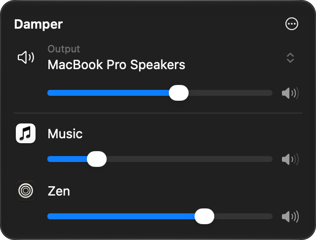

# Damper

A small native menu bar mixer for macOS. It lets you set the volume of each app separately.



## What it does

- Lists the apps playing sound in a panel under a menu bar icon, each with a slider and a mute button.
- Remembers each app's level and applies it again the next time that app plays.
- Lets you pick the output device and set its volume and mute, so you don't need the system menu as well.
- Can pause all levels at once, and can ignore an app so it's left alone.

An app can only be turned down, never up past its own volume. Levels apply while Damper is running, so turn on Open at Login if you want them after a restart.

It has no equalizer, boost, per-app output routing or per-tab browser control, and that's on purpose. It installs no audio driver. It uses Core Audio process taps, which macOS provides for this.

## Install

Damper needs macOS 26 or later on an Apple silicon Mac.

Download the zip from the [latest release](https://github.com/tadassuksteris/damper/releases/latest) and move `Damper.app` to Applications, or use Homebrew:

```sh
brew install --cask tadassuksteris/tap/damper
```

Damper checks for updates once a day and asks before installing one. You can turn that off in Settings.

To build it yourself, you need Xcode 26 or later. Quit Damper first if it's running:

```sh
./scripts/build.sh release
rm -rf /Applications/Damper.app && mv build/Damper.app /Applications/ && open /Applications/Damper.app
```

A build of your own is signed ad hoc for your Mac and doesn't update itself. macOS treats each rebuild as a new app, so you may have to allow audio access again afterwards.

## Permissions and privacy

Damper needs system audio access (System Settings > Privacy & Security > Screen & System Audio Recording > System Audio Recording Only). To change an app's level, it has to read that app's audio and play it back quieter, and macOS counts that as recording. You may see the recording indicator while levels are on.

Audio is processed in memory and is never saved or sent anywhere. The app has no recording feature or analytics, and it runs in the App Sandbox. The only network traffic is checking GitHub for updates, which sends no audio or usage data. It stores only app bundle IDs, their levels and a few settings. It's signed with the audio-input entitlement, as Apple's tap sample is, but it never opens a microphone.

macOS has no public way to check this permission, so the app calls a private system function to read and request it. That is the only private API it uses. Levels still start only once real audio comes through, but if the function reports that access was turned off, they stop. `./scripts/build.sh release -Xswiftc -DDAMPER_NO_PRIVATE_TCC` leaves it out.

## Known limits

**A lowered or muted app can still be heard sometimes**, so don't rely on mute for privacy:

- Levels take hold just after an app starts playing, so the start of playback and short sounds, like notifications, can come through at full volume.
- The same happens for a moment after you switch outputs.
- If you pause levels or quit the app, apps go back to their own volume.

**Some outputs aren't supported**, and apps play at their own volume on them:

- Devices with a microphone, including some headsets and USB interfaces
- Aggregate and multi-output devices
- Devices with more than one output stream or more than two channels
- Devices set above 192 kHz, or whose stereo pair isn't channels 1 and 2
- Devices another app is using exclusively

**Some apps can't be adjusted:**

- Safari and other WebKit apps play through a shared system process, which shows up as one disabled "Web content" row.
- Players started from Terminal, and apps playing to a different output from the system one.

## Status

Damper is early and has been tested on one Mac, running macOS 27. CI builds and tests it on macOS 26, but the app hasn't been run there yet. Bluetooth with levels applied, calls and long sessions are untested, so bug reports from other setups are welcome.

## Contributing

See [CONTRIBUTING.md](CONTRIBUTING.md) for how it works and how to build and test it.

To report a security problem, use **Report a vulnerability** on the repository's Security tab rather than a public issue.

## License

MIT. See [LICENSE](LICENSE). Updates use [Sparkle](https://sparkle-project.org), and its license is included in the app.
